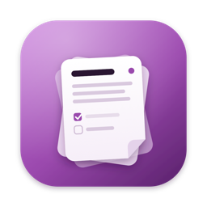
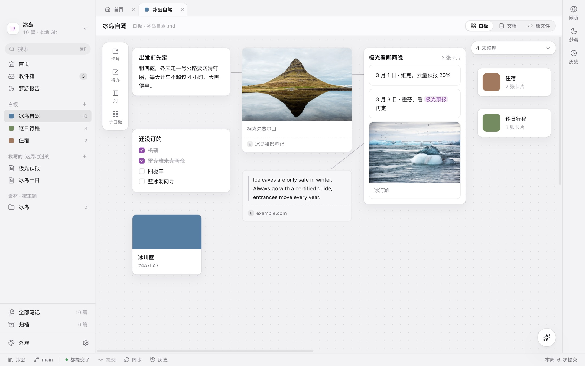
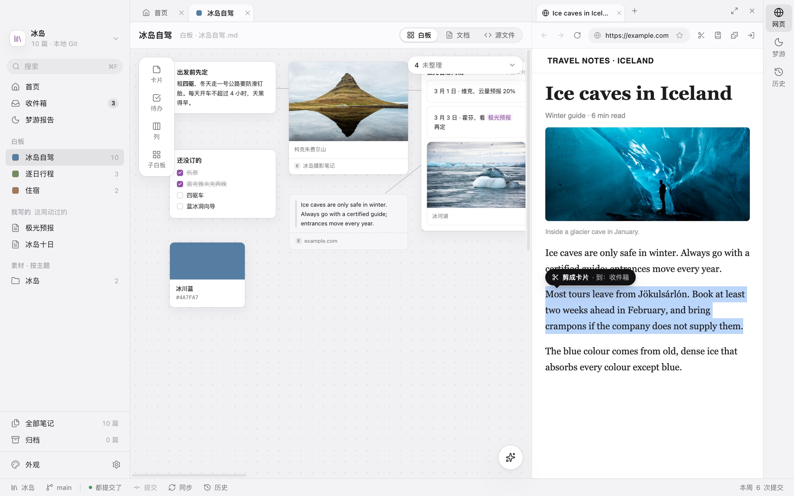
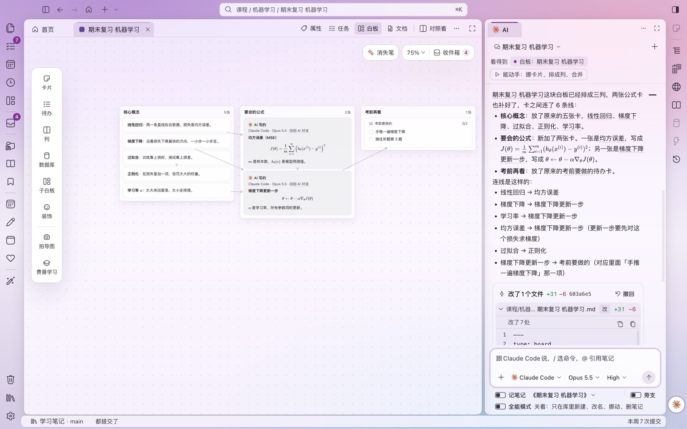
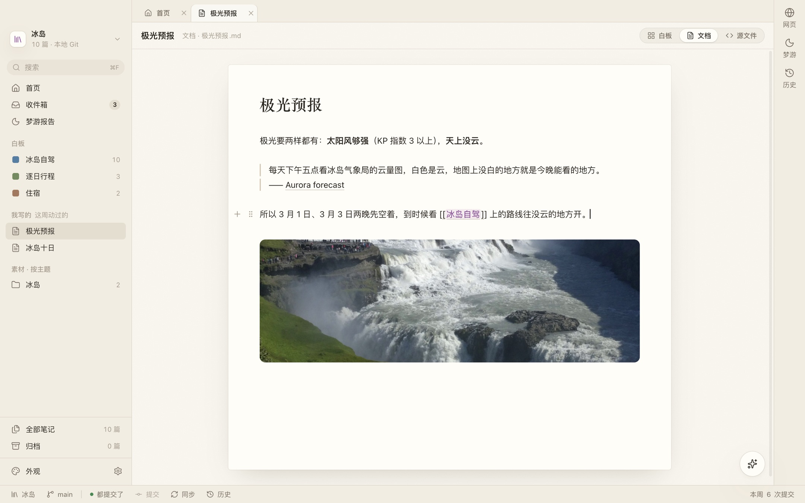
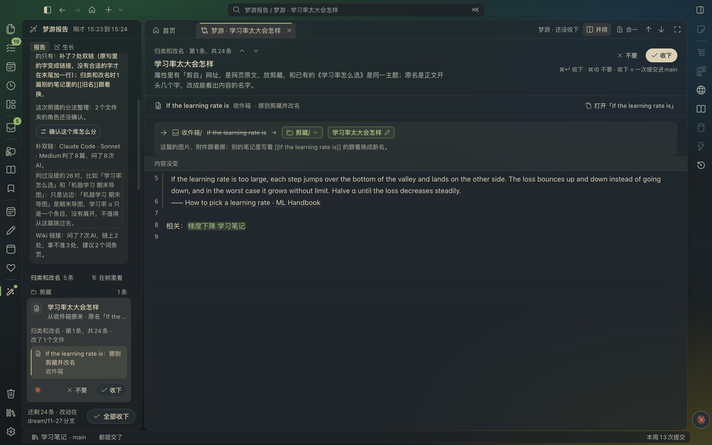
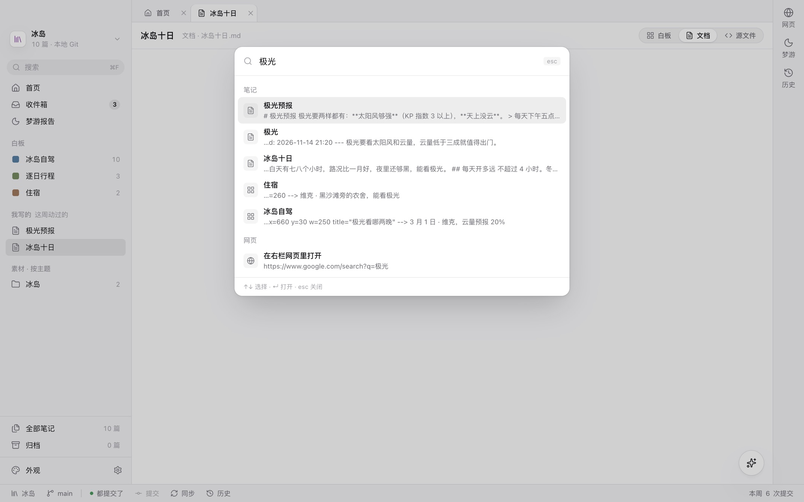
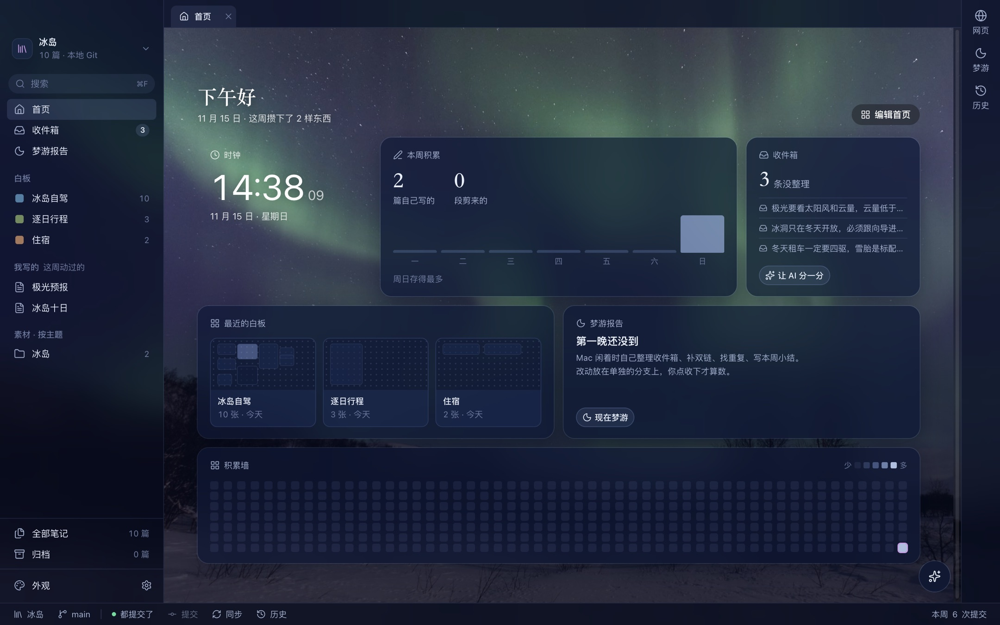

<p align="center"></p>

<h1 align="center">Canvas Notes</h1>

<p align="center"><b>Notes that are plain Markdown files: a whiteboard and a document in one file, a browser beside it to clip from, and an AI that tidies up through the command line you already have.</b></p>

<p align="center">
<a href="https://github.com/SchaeferAnjon/canvas-notes/releases/latest/download/CanvasNotes-mac-arm64.dmg"><b>Download for Mac (Apple silicon)</b></a> ·
<a href="https://github.com/SchaeferAnjon/canvas-notes/releases/latest/download/CanvasNotes-mac-x64.dmg">Mac (Intel)</a> ·
<a href="https://canvas-note.us-cloud.uk/?lang=en">Website</a>
</p>

<p align="center">
<a href="https://github.com/SchaeferAnjon/canvas-notes/releases/latest"></a>
<a href="LICENSE"></a>

</p>

<p align="center"><sub><b>English</b> · <a href="README.zh-CN.md">简体中文</a></sub></p>

<p align="center"><picture><source media="(prefers-color-scheme: dark)" srcset="website/shots/board-dark.jpg"></picture></p>

## What it does

Save first, sort later. Clippings land in the inbox, anything you write can be spread out on a board, and the AI tidies up when you ask, or on its own at night. The app is in Chinese; its name in Chinese is 画布笔记.

- **One file, two views**: open a note as a whiteboard (cards, columns, to-dos, images, sub-boards, links) or as a document that reads top to bottom. The layout lives in Markdown comments, so Obsidian, Typora or VS Code still show a readable article.
- **Clip from the web**: a full Chromium browser on the right. Select a paragraph and it becomes a card on the board or a quote at the cursor in a document, with its source. Import your Chrome sign-ins, bookmarks, history and extensions.
- **Built-in plugins**: 双语翻译 (bilingual translation, <kbd>⌥</kbd> <kbd>A</kbd>) and 书签管家 (bookmark manager) live in the web panel (translate in the address bar, bookmarking under ⋯ › 加书签; new tabs run the new-tab page of [BookmarkKeeper](https://github.com/SchaeferAnjon/bookmark) as-is, with quick bookmarks synced with Chrome and Safari through iCloud); turn them on or off in the plugin panel and in Settings › Plugins. The small arrow next to the translate button picks the language, side-by-side or translation-only, and one of seven translation styles. Translation goes through your AI command line (Claude Code → Codex → Gemini → OpenCode); with none of them you can add your own DeepSeek or Zhipu API key (kept in the Keychain), and a course folder's `术语表.md` glossary keeps terms consistent.
- **An AI that acts**: the assistant uses Claude Code, Codex, Gemini or OpenCode, whichever is signed in on your Mac. It creates, renames, moves and deletes notes (links follow), adds and arranges cards, inserts and rewrites text, opens and clips pages. In full-access mode (on by default) it can also read and write files anywhere on your Mac, run commands and search the web, like the CLI in a terminal; switch it off to keep the AI inside your vault. Each turn is one Git commit you can undo.
- **Dreaming**: while the Mac is idle, the AI files the inbox, adds links, finds duplicates and writes a weekly summary on a separate branch. You accept or drop each change the next day; your own writing is never touched.
- **⌘F** searches titles and full text, and runs commands.
- **Git history**: changes are committed automatically; Sync pushes to a remote you own.
- **Six themes and a home page you arrange**: family grey light and dark, White, Cream, Black, Deep sea; two home styles with draggable widgets.
- **Quick note**: <kbd>⌥</kbd> <kbd>⌘</kbd> <kbd>N</kbd> in any app; Enter puts it in the inbox.

## Screenshots

The app with a sample vault (an Iceland road trip). The AI shot uses the app's built-in test engine, which runs the same tools without calling a model.

<table>
<tr>
<td width="50%" align="center"><br><sub>Clip from the browser</sub></td>
<td width="50%" align="center"><br><sub>The AI working on a board</sub></td>
</tr>
<tr>
<td align="center"><br><sub>Document view, Cream theme</sub></td>
<td align="center"><br><sub>Dream report</sub></td>
</tr>
<tr>
<td align="center"><br><sub>⌘F</sub></td>
<td align="center"><br><sub>Home page, Deep sea theme</sub></td>
</tr>
</table>

## Install

| | Download | Needs |
|---|---|---|
| **Mac with Apple silicon** (M1 to M4) | [`CanvasNotes-mac-arm64.dmg`](https://github.com/SchaeferAnjon/canvas-notes/releases/latest/download/CanvasNotes-mac-arm64.dmg) | macOS 12 or later |
| **Mac with an Intel chip** | [`CanvasNotes-mac-x64.dmg`](https://github.com/SchaeferAnjon/canvas-notes/releases/latest/download/CanvasNotes-mac-x64.dmg) | macOS 12 or later |

Open the dmg, drag Canvas Notes into Applications, open it and pick a folder as your vault: an empty one, or an existing Obsidian vault. Git is required; macOS offers to install the command line tools the first time. The app is not notarized by Apple (the author's other apps are not either): if macOS says it cannot verify the developer the first time you open it, right-click Canvas Notes in Finder and choose Open, or click Open Anyway in System Settings › Privacy & Security. For the AI, install and sign in to one of [Claude Code](https://claude.com/claude-code), [Codex](https://github.com/openai/codex), [Gemini CLI](https://github.com/google-gemini/gemini-cli) or [OpenCode](https://opencode.ai) in a terminal; the app finds it.

Earlier versions are on the [releases page](https://github.com/SchaeferAnjon/canvas-notes/releases). There is no auto-update yet: download the new version from the same place. Windows and mobile versions do not exist yet.

## Privacy

- No account, no server, no usage statistics. The app itself sends nothing anywhere.
- Notes are plain files in the folder you pick; settings, AI chat history, browser tabs, bookmarks and history are in the app's settings folder.
- The AI sends what a turn needs (the current board or document, selected cards, notes you @-mention, the open page) to the command-line tool you chose, which sends it to its own service, the same as using it in a terminal.
- Sync only pushes to a Git remote you set up. Imported Chrome sign-ins are used only by the built-in browser.

## Build from source

```bash
pnpm install
pnpm dev                 # opens a window; pick a folder as the vault
pnpm test                # unit tests
pnpm typecheck
pnpm test:e2e            # builds, then drives the real Electron window with Playwright
```

Code layout, tests, releases and the website: [docs/DEVELOPMENT.md](docs/DEVELOPMENT.md) (in Chinese).

## License

[GPL-3.0-or-later](LICENSE). Copyright © 2026 Jia Zonghan.

`packages/design/src/tokens.css` and `ui.css` started as copies from [MeetCaption](https://github.com/SchaeferAnjon/meetcaption) (GPL-3.0-or-later, same author). Bundled libraries, the cover photos (CC0) and the parts that follow other projects are listed in [THIRD_PARTY_NOTICES.md](THIRD_PARTY_NOTICES.md).
