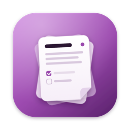
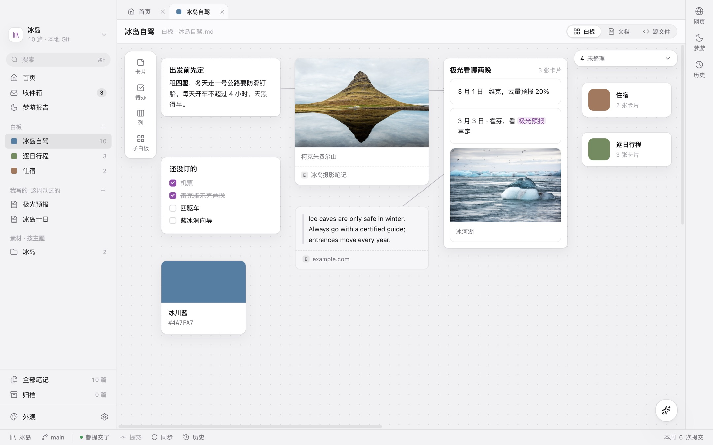
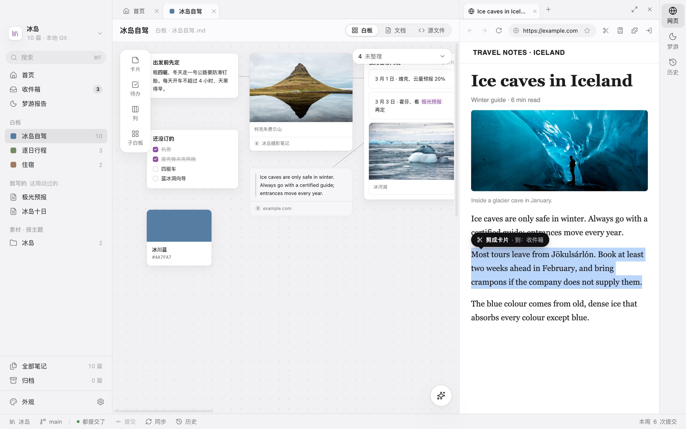
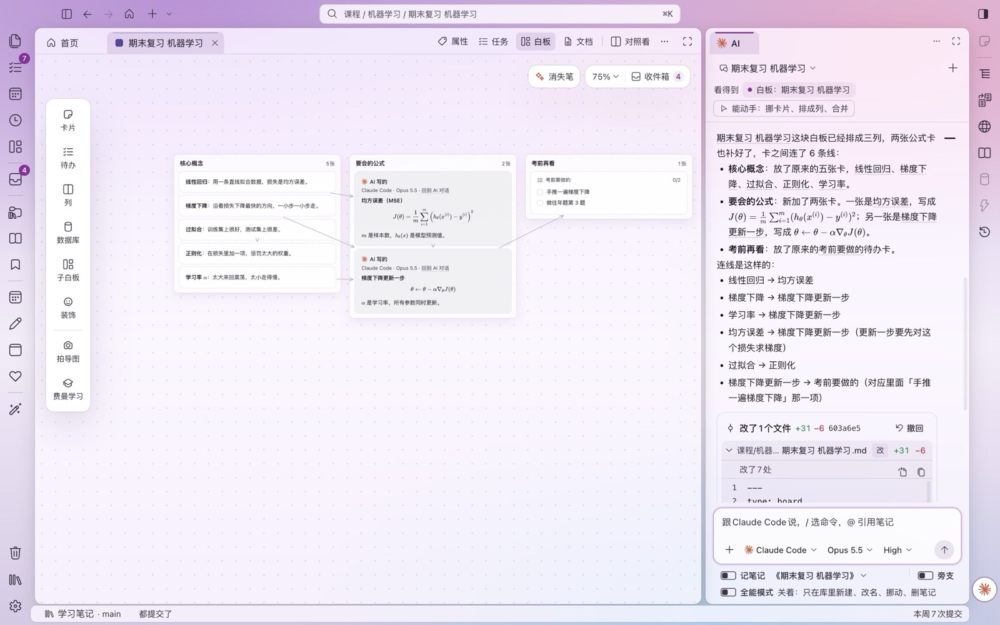
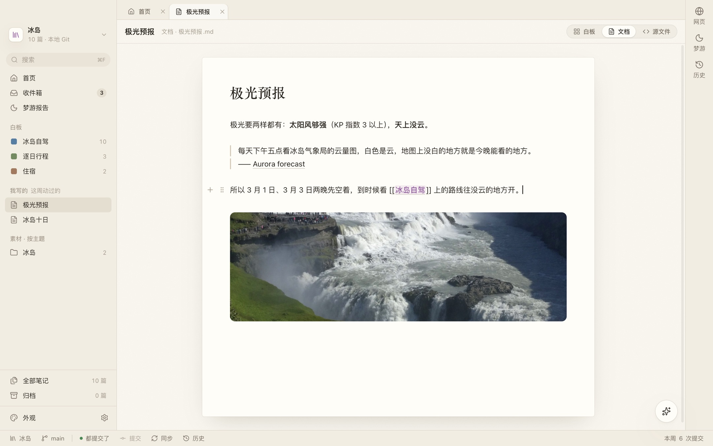
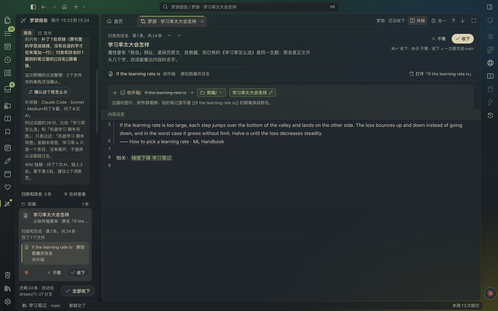
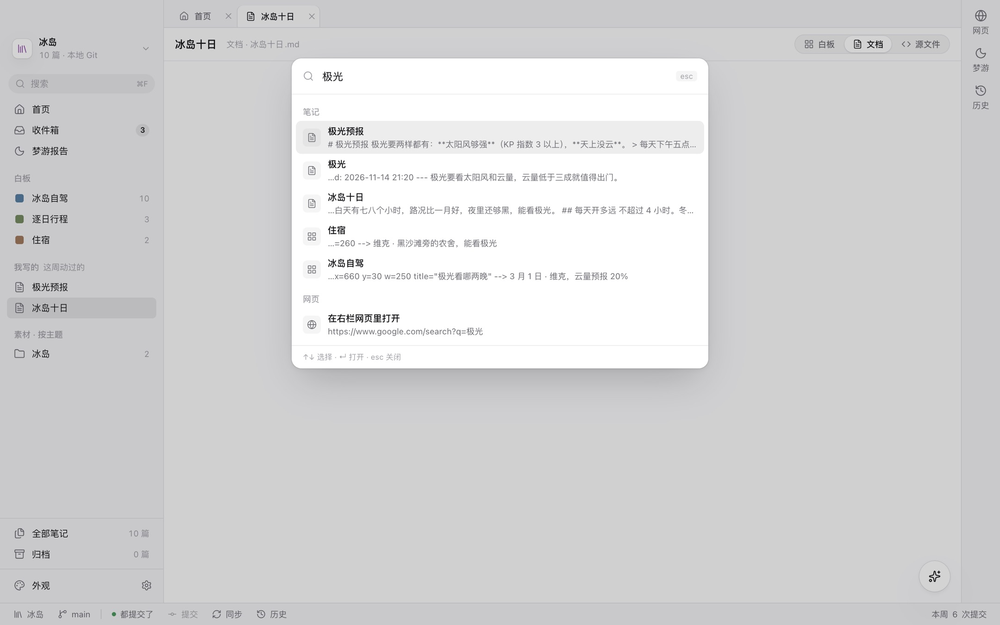
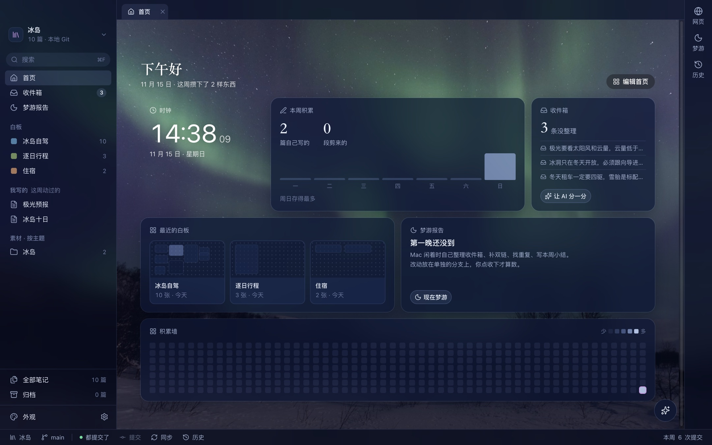

<p align="center"></p>

<h1 align="center">Canvas Notes · 画布笔记</h1>

<p align="center"><b>白板和文档是同一个 Markdown 文件，旁边开着网页随手剪，AI 用你电脑上已有的命令行替你整理。</b></p>

<p align="center">
<a href="https://github.com/SchaeferAnjon/canvas-notes/releases/latest/download/CanvasNotes-mac-arm64.dmg"><b>下载 Mac 版（Apple 芯片）</b></a> ·
<a href="https://github.com/SchaeferAnjon/canvas-notes/releases/latest/download/CanvasNotes-mac-x64.dmg">Mac 版（Intel）</a> ·
<a href="https://canvas-note.us-cloud.uk">官网</a>
</p>

<p align="center">
<a href="https://github.com/SchaeferAnjon/canvas-notes/releases/latest"></a>
<a href="LICENSE"></a>

</p>

<p align="center"><sub><a href="README.md">English</a> · <b>简体中文</b></sub></p>

<p align="center"><picture><source media="(prefers-color-scheme: dark)" srcset="website/shots/board-dark.jpg"></picture></p>

## 能做什么

随手存，自动整理，随时看得到自己积累了什么。剪进来的先进收件箱，写的东西随时能在白板上摆开，AI 在你说的时候、或者夜里自己替你收拢。

- **一个文件，两种看法**：一篇笔记点「白板」摊成卡片（卡片、列、待办、图片、子白板、连线），点「文档」从上往下读。排版写在 md 的注释里，用别的编辑器打开看到的是一篇从上往下的文章。
- **网页剪藏**：右边是完整的 Chrome 内核。选中一段，白板里「剪成卡片」，文档里「剪进文档」插到光标处，来源自动带上；整页剪藏存成收件箱里新的一篇。一键导入 Chrome 的登录、书签、历史和插件。
- **内置插件**：网页地址栏里的「双语翻译」（<kbd>⌥</kbd> <kbd>A</kbd>）和「书签管家」（「⋯ › 加书签」；新网页标签直接是 [BookmarkKeeper](https://github.com/SchaeferAnjon/bookmark) 的新标签页，快捷书签经 iCloud 和 Chrome、Safari 同步）是内置插件，在插件面板和 设置 › 插件 里开关。翻译按钮旁的小箭头里换语言、对照 / 只看译文和七种译文样式；翻译走你的 AI 命令行（Claude Code → Codex → Gemini → OpenCode），都没有时可以填自己的 DeepSeek 或智谱 API Key（存在钥匙串里），课程文件夹里的 `术语表.md` 让译法前后一致。
- **AI 能动手**：右下角的 AI 用这台 Mac 上已经登录的 Claude Code、Codex、Gemini 或 OpenCode，不另存密钥。它能新建、改名、挪动、删笔记（链接跟着改），在白板上加卡片、排成列，在文档里插入、改写，在网页里打开、剪藏；全能模式（默认开）下还能像在终端里一样读写这台 Mac 上的文件、跑命令、上网，关掉就只在库里动手。每一轮是一次 Git 提交，点「撤回」就回去。
- **梦游**：Mac 闲着时，AI 在单独的分支上给收件箱分类、补双链、找重复、写本周小结；第二天一条条收下或丢掉，你写的正文一个字不动。
- **⌘F**：搜标题和正文，也能执行命令。
- **Git 历史**：自动提交，每一步能撤回；配上自己的远程仓库，「同步」一下在几台电脑间来回。
- **六套主题，首页自己摆**：家族灰（浅、深）、纯白、米白、纯黑、深海蓝；首页两种样式，组件能拖、能收、能换大小。
- **速记**：任何软件里按 <kbd>⌥</kbd> <kbd>⌘</kbd> <kbd>N</kbd>，回车进收件箱。

## 截图

真软件加一个样本库（冰岛自驾）。AI 那张用的是软件自带的测试引擎：工具调用是真的，只是不调模型。

<table>
<tr>
<td width="50%" align="center"><br><sub>从网页剪藏</sub></td>
<td width="50%" align="center"><br><sub>AI 在白板上动手</sub></td>
</tr>
<tr>
<td align="center"><br><sub>文档，米白主题</sub></td>
<td align="center"><br><sub>梦游报告</sub></td>
</tr>
<tr>
<td align="center"><br><sub>⌘F</sub></td>
<td align="center"><br><sub>首页，深海蓝主题</sub></td>
</tr>
</table>

## 下载

| | 下载 | 要求 |
|---|---|---|
| **Apple 芯片的 Mac**（M1 到 M4） | [`CanvasNotes-mac-arm64.dmg`](https://github.com/SchaeferAnjon/canvas-notes/releases/latest/download/CanvasNotes-mac-arm64.dmg) | macOS 12 或更新 |
| **Intel 芯片的 Mac** | [`CanvasNotes-mac-x64.dmg`](https://github.com/SchaeferAnjon/canvas-notes/releases/latest/download/CanvasNotes-mac-x64.dmg) | macOS 12 或更新 |

打开 dmg，把 Canvas Notes 拖进「应用程序」，打开后选一个文件夹当库：空文件夹，或者已经放着 md 的文件夹都行；以前在 Obsidian 里写的笔记，用「文件 › 导入旧笔记…」搬进来。需要 Git，第一次用时 macOS 会提示安装命令行工具。这一版没有经过 Apple 公证（作者的其他软件也没有）：第一次打开时如果提示「无法验证开发者」，macOS 15 及以后到 系统设置 › 隐私与安全性 里点「仍要打开」（右键「打开」已经绕不过这个提示）；macOS 14 及更早，在访达里右键点 Canvas Notes 选「打开」。要用 AI，先在终端里装好并登录 [Claude Code](https://claude.com/claude-code)、[Codex](https://github.com/openai/codex)、[Gemini CLI](https://github.com/google-gemini/gemini-cli) 或 [OpenCode](https://opencode.ai) 中的一个，软件会自己找到它。

以前的版本在[发布页](https://github.com/SchaeferAnjon/canvas-notes/releases)。还没有自动更新：新版本从同一个地方下载。Windows 和手机版还没有。

## 隐私

- 没有账号，没有服务器，没有使用统计，软件自己不往任何地方发东西。
- 笔记是你选的文件夹里的普通文件；设置、AI 对话记录、网页标签、书签和历史在软件的设置目录里。
- AI 只把这一轮要看的内容（当前白板或文档、选中的卡片、@ 的笔记、开着的网页）交给你选的命令行，由它发给它自己的服务，和你在终端里用它一样。
- 同步只推到你自己填的 Git 远程仓库。导入的 Chrome 登录只在内置浏览器里用。

## 开发

```bash
pnpm install
pnpm dev                 # 打开窗口，选一个文件夹当库
pnpm test                # 单元测试
pnpm typecheck
pnpm test:e2e            # 构建后用 Playwright 驱动真的 Electron 窗口
```

代码结构、测试、发版和官网：[docs/DEVELOPMENT.md](docs/DEVELOPMENT.md)。

## 许可证

[GPL-3.0-or-later](LICENSE)。Copyright © 2026 Jia Zonghan。

`packages/design/src/tokens.css` 和 `ui.css` 的起点拷自 [MeetCaption](https://github.com/SchaeferAnjon/meetcaption)（GPL-3.0-or-later，同一个作者）。随包分发的库、封面照片（CC0）和参照别的项目写的部分见 [THIRD_PARTY_NOTICES.md](THIRD_PARTY_NOTICES.md)。
